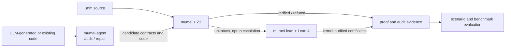
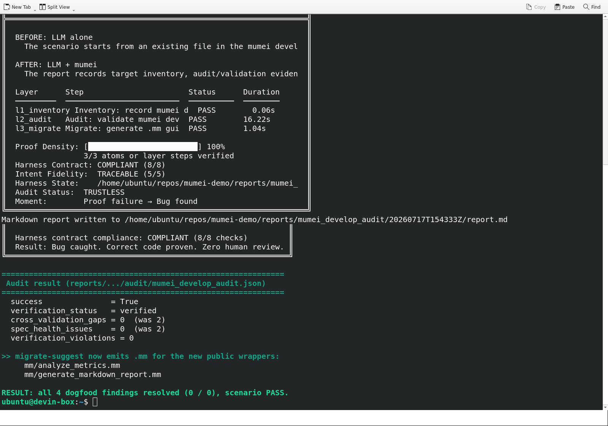
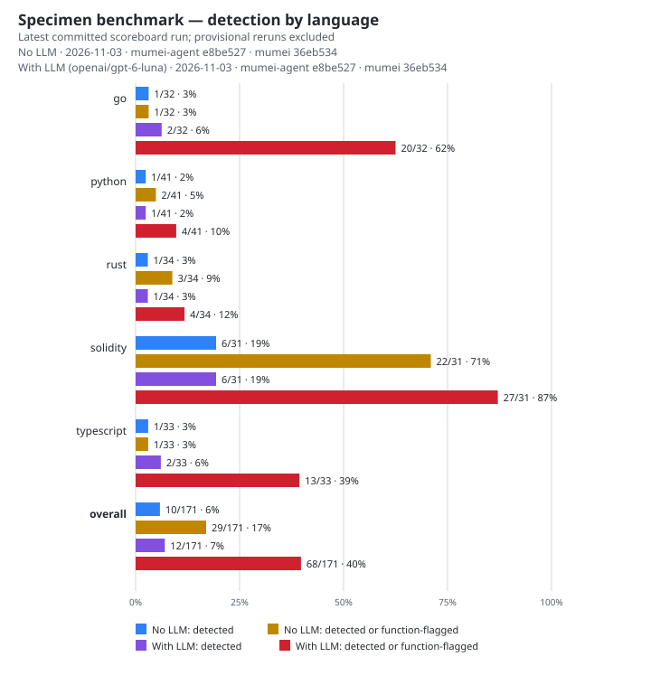
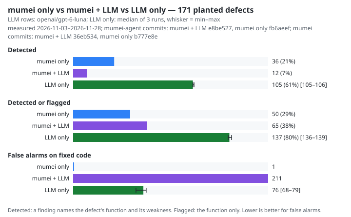

# Mumei Demo

> **Mumei proves that LLM-generated code has bugs — mathematically.**

Mumei checks code against formal contracts before generation mistakes reach production. This repository is the executable evidence pack: scenario demos, audit and contract benchmarks, and proof artifacts. The implementation lives in [`mumei`](https://github.com/mumei-lang/mumei), [`mumei-agent`](https://github.com/mumei-lang/mumei-agent), and [`mumei-lean`](https://github.com/mumei-lang/mumei-lean).

## Quick start

```bash
make setup && make demo
```

Use `CI_FIXTURE_MODE=1 make demo-ci` for the deterministic validation path. Setup, every demo target, dashboards, optional experiments, and troubleshooting are in [`docs/DEMO_GUIDE.md`](docs/DEMO_GUIDE.md); command and environment details are in [`docs/REFERENCE.md`](docs/REFERENCE.md). The GitHub Actions audit-evidence adoption path is in [`docs/CI_REFERENCE.md`](docs/CI_REFERENCE.md).

## What the demo shows

| Scenario | Bug an LLM can miss | Mumei evidence |
|---|---|---|
| Ownership Transfer | `hostile_takeover` skips `accept` and tries `Idle → Transferred`. | Effect checking rejects `InvalidPreState`. |
| RTGS Settlement | A transfer breaks balance conservation or settles before validation. | Z3 checks contracts; Lean certifies deeper invariants when available. |
| RegTech Compliance | A `match` omits `CustomerType::PEP`. | Exhaustiveness checking reports the missing case. |
| No-.mm Multi-language Audit | Existing code has no `.mm` specification yet. | The audit gate reports violations, counterexamples, and `next_steps`. |

The full scenario list, including negative controls, charter gating, DeFi invariants, and test-observation checks, is in [`docs/SCENARIO_CATALOG.md`](docs/SCENARIO_CATALOG.md).



The diagram shows the upstream verification and opt-in escalation flow. Some scenarios additionally pass an already emitted proof certificate to the mumei-lean bridge as certificate-integration evidence, even when Z3 verification succeeded. The demo evaluates recorded evidence; it does not turn finite replay, LLM output, or a successful scenario into additional proof.

## Verification demo: dogfooding audit

The `mumei_develop_audit` scenario passes all three layers with zero original findings. Evidence, metrics, before/after output, and recordings are in [`docs/DEMO_SHOWCASE.md#mumei-develop-audit-dogfooding-verification`](docs/DEMO_SHOWCASE.md#mumei-develop-audit-dogfooding-verification).



## Benchmark evidence

The benchmark lanes measure different claims, so there is no combined score. The figures below are committed evidence snapshots with their measurement date, tool commit, and model; exploratory reruns do not replace them until their review state is complete. Lane definitions and the latest remeasurement notes are in [`docs/BENCHMARKS.md`](docs/BENCHMARKS.md).

<!-- scoreboard:start -->
### Specimen benchmark

An executable corpus of deliberately broken Python/TypeScript/Go/Rust/Solidity apps with ground-truth defects, scored with `mumei-agent audit`. It includes defect classes the tools don't detect yet, so the score is expected to rise over time.



Latest committed baseline:

- No LLM — 2026-11-28, mumei-agent `45f5345`, mumei `b777e8e`: 13/171 detected (8%), 27/171 detected or function-flagged, precision 60%–92% of 25 findings, adjudication incomplete (8 unreviewed, 0 stale), 1 false alarms on fixed code (16 specimens)
- With LLM (`openai/gpt-6-luna`) — 2026-11-03, mumei-agent `e8be527`, mumei `36eb534`: 12/171 detected (7%), 68/171 detected or function-flagged, precision 10%–87% of 200 findings, adjudication incomplete (339 unreviewed, 0 stale), 211 false alarms on fixed code (16 specimens)

Exploratory reruns are not folded into this baseline until finding adjudication is current.

Details and history: [specimens/README.md#scoreboard](specimens/README.md#scoreboard).
<!-- scoreboard:end -->

The newer 2026-11-25 no-LLM remeasurement found 11/171 defects with 28 fixed-code alarms. It remains provisional because 47 buggy/fixed findings were unreviewed (24 buggy, 23 fixed) and one prior review matches neither available audit mode; see [`docs/BENCHMARKS.md`](docs/BENCHMARKS.md).

### Contract benchmark

This benchmark checks whether one written contract separates each buggy function from its fixed version. The right answer is “buggy refuted, fixed proven”; the reference row is a contract-expression check, not a detection result.

<!-- contract-bench:start -->

Evidence snapshot: recorded 2026-11-03 and 2026-11-05; verifier for mumei-checked rows `mumei 0.6.23` (`663efd3`).

| Arm | Model | Both right | False acceptance | False positive | Cost |
|---|---|---:|---:|---:|---:|
| mumei (reference ports) | — | 71 / 71 | 0 | 0 | — |
| LLM only (judges the source) | openai/gpt-6-luna | 66 / 71 | 0 (0–1) | 5 (4–5) | $0.11 |
| mumei + LLM (LLM ports, mumei checks) | openai/gpt-6-luna | 59 (58–60) / 71 | 0 | 0 | $0.15 |
| mumei + LLM contract (LLM writes the contract, reference ports) | openai/gpt-6-luna | 58 (58–59) / 71 | 2 (1–3) | 9 (9–10) | $0.06 |

Fidelity gate note: mumei + LLM (LLM ports, mumei checks) excludes 12 (12–13) raw verifier proof(s) per run from acceptance. False acceptance and fixed-proven are post-gate projections; raw verifier outcomes, unresolved/unsupported rows and fixed-side impact are in [proofs/RESULTS.md](proofs/RESULTS.md).

The reference row uses hand-written ports, so it is a contract-expression check rather than a detection result. Full outcome taxonomy, per-language results and caveats: [proofs/RESULTS.md](proofs/RESULTS.md).

<!-- contract-bench:end -->

<!-- comparison:start -->
### mumei only vs mumei + LLM vs LLM only



Evidence snapshot: measured 2026-11-03–2026-11-28; mumei-agent commits: mumei + LLM `e8be527`, mumei only `45f5345`; mumei commits: mumei + LLM `36eb534`, mumei only `b777e8e`.

| | Detected | Detected or flagged | Precision | False alarms on fixed code | Cost per pass | Time per pass |
|---|---:|---:|---:|---:|---:|---:|
| mumei only | 13 (8%) | 27 (16%) | 60%–92% | 1 | $0.00 | 111 s wall |
| mumei + LLM | 12 (7%) | 68 (40%) | 10%–87% | 211 | $0.22 | 54 min wall |
| LLM only (3 runs, median) | 104 (61%), range 104–105 | 136 (80%), range 135–138 | 62%–100% | 76, range 68–79 | $0.06 | 22 min model time |

Same 171 planted defects and the same scoring for every row; LLM rows use `openai/gpt-6-luna`.
Precision is a range while findings are unreviewed (median unreviewed per run: mumei only 8, mumei + LLM 154, LLM only 65).
Of the 212 mumei + LLM findings on fixed code (211 false alarms, 1 reviewed as real), 183 are spec diagnostics (cross-check gaps and spec health issues) rather than verifier violations.
Details, complementarity, findings by kind and per-language numbers: [specimens/COMPARISON.md](specimens/COMPARISON.md).
<!-- comparison:end -->

## Architecture

| Layer | Repository | Role |
|---|---|---|
| L1 | [`mumei`](https://github.com/mumei-lang/mumei) + Z3 | Contract language, automatic verification, compilation evidence |
| L2 | [`mumei-agent`](https://github.com/mumei-lang/mumei-agent) | AI-guided repair, extraction, and multi-language audit orchestration |
| L3 | [`mumei-lean`](https://github.com/mumei-lang/mumei-lean) + Lean 4 | Independent proof backend for escalated obligations |

The ownership and acceptance boundary across these repositories is defined in [mumei's verification-native architecture](https://github.com/mumei-lang/mumei/blob/develop/docs/VERIFICATION_NATIVE.md). This repository measures capability and non-capability through reproducible scenarios; stronger assurance must come from the relevant trusted checker, not from demo success.

## Documentation

| Document | Contents |
|---|---|
| [`docs/SCENARIO_CATALOG.md`](docs/SCENARIO_CATALOG.md) | Full scenario catalog and output examples |
| [`docs/DEMO_GUIDE.md`](docs/DEMO_GUIDE.md) | Setup, all targets, optional demos, dashboards, troubleshooting |
| [`docs/BENCHMARKS.md`](docs/BENCHMARKS.md) | Benchmark lanes, measurement dates, tool commits, remeasurements |
| [`docs/DEMO_SHOWCASE.md`](docs/DEMO_SHOWCASE.md) | Recordings and detailed dogfooding evidence |
| [`docs/SCENARIO_SPEC.md`](docs/SCENARIO_SPEC.md) | Scenario schema and how to add scenarios |

## License

Apache-2.0; see [`LICENSE`](LICENSE).
