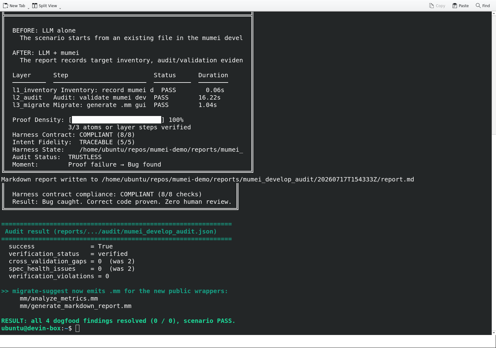
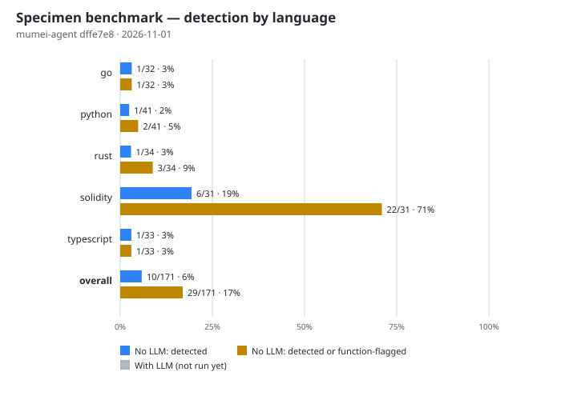
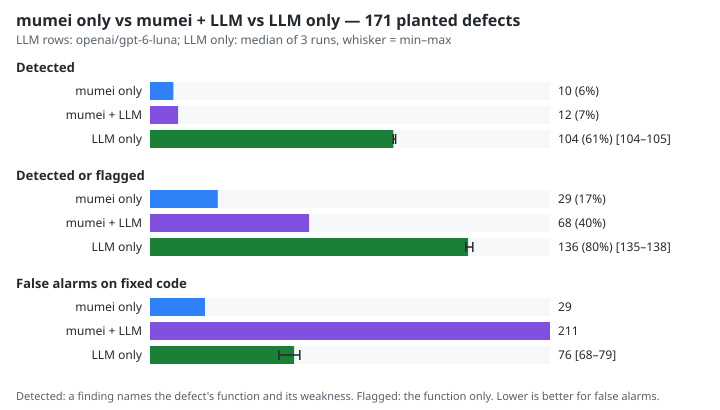

# Mumei Demo

> **Mumei proves that LLM-generated code has bugs — mathematically.**

Mumei runs formal verification over every possible case before an LLM-generated bug becomes a production incident. The representative scenarios below show the same contract pipeline catching concrete failures; the full catalog is in [`docs/SCENARIO_CATALOG.md`](docs/SCENARIO_CATALOG.md).

| Scenario | Bug an LLM can miss | How Mumei catches it |
|---|---|---|
| Ownership Transfer | `hostile_takeover` skips `accept` and tries `Idle → Transferred`. | Effect checking rejects `InvalidPreState`. |
| RTGS Settlement | A transfer can break balance conservation or settle before validation. | Z3 checks contracts; Lean certifies deeper invariants when available. |
| RegTech Compliance | `PEP` customers are missing from a `match`. | Exhaustiveness checking reports `CustomerType::PEP (tag=3)`. |
| No-.mm Multi-language Audit | Existing code enters before any `.mm` file exists. | The audit gate reports violations, counterexamples, and `next_steps`. |
| DeFi Invariant | Integer overflow occurs in an ERC-20 transfer. | Refinement types prevent overflow at compile time. |
| Charter Gate | A repair weakens a reviewed dosage contract or relies on a low-grade proof. | The charter gate rejects weakened, narrowed, under-graded, and unpinned candidates. |
| Negative Controls | A dosage implementation verifies under a contract that permits a wrong result. | Controls and Phase 1i expose a surviving mutant; the strong contract is discriminating. |
| Test Observations | A late-fee contract predicts the wrong result or admits a rejected input. | Harvested Python and Rust tests expose contradictions and confirm an aligned spec and `.mm` atom. |

## How It Works

```text
LLM generates code
      ↓
mumei verifies (Z3 — automatic)
      ↓
  ✅ Proven safe        ❌ Counter-example found
      ↓                       ↓
  LLVM binary           AI agent fixes & retries
      ↓
  Lean 4 certifies properties beyond Z3's reach
```

The key insight: mumei is the contract language every proof engine shares. Z3 and Lean 4 are layers in one Proof Certificate Chain.

```text
Without mumei:  LLM skips the accept step → deployed → attacker takes over.
With mumei:     mumei ❌ InvalidPreState: 'accept' requires 'PendingTransfer'
                       but current state is 'Idle' → Bug caught at compile time.
```

## Verification demo: dogfooding audit

The `mumei_develop_audit` scenario now passes all three layers with zero original findings. Details, metrics, before/after evidence, and recording are in [`docs/DEMO_SHOWCASE.md#mumei-develop-audit-dogfooding-verification`](docs/DEMO_SHOWCASE.md#mumei-develop-audit-dogfooding-verification).



<!-- scoreboard:start -->
## Specimen benchmark

An executable corpus of deliberately broken Python/TypeScript/Go/Rust/Solidity apps with ground-truth defects, scored with `mumei-agent audit`. It includes defect classes the tools don't detect yet, so the score is expected to rise over time.



Latest — no LLM: 10/171 detected (6%), 29/171 detected or function-flagged, precision 32% of 40 findings, 29 false alarms on fixed code (16 specimens) · with LLM (`openai/gpt-6-luna`): 12/171 detected (7%), 68/171 detected or function-flagged, precision 10%–87% of 200 findings, 211 false alarms on fixed code (16 specimens)

Details and history: [specimens/README.md#scoreboard](specimens/README.md#scoreboard).
<!-- scoreboard:end -->

## Contract benchmark

The specimen benchmark measures finding bugs in existing code. This one measures what Mumei is for: checking code against a contract. Each of the 71 specimen defects in a category Mumei targets has a written requirement and one contract that the buggy and the fixed function are both checked against; the right answer is "buggy refuted, fixed proven". Run with `python3 scripts/run_contract_bench.py`; CI only runs `--check`, offline.

<!-- contract-bench:start -->

| Arm | Model | Runs | Buggy refuted | Fixed proven | Both right | Buggy accepted | Fixed rejected | Inconclusive | Cost |
|---|---|---:|---:|---:|---:|---:|---:|---:|---:|
| mumei (reference ports) | — | 1 | 71 / 71 | 71 / 71 | 71 | 0 | 0 | 0 | — |
| LLM only (judges the source) | openai/gpt-6-luna | 3 | 71 (70–71) / 71 | 66 (66–67) / 71 | 66 | 0 (0–1) | 5 (4–5) | 0 | $0.11 |
| mumei + LLM (LLM ports, mumei checks) | openai/gpt-6-luna | 3 | 62 (59–62) / 71 | 67 / 71 | 58 (55–58) | 8 (7–10) | 2 (2–3) | 3 (3–4) | $0.14 |

Details, per-language results and caveats: [proofs/RESULTS.md](proofs/RESULTS.md).

<!-- contract-bench:end -->

<!-- comparison:start -->
### mumei only vs mumei + LLM vs LLM only



| | Detected | Detected or flagged | Precision | False alarms on fixed code | Cost per pass | Time per pass |
|---|---:|---:|---:|---:|---:|---:|
| mumei only | 10 (6%) | 29 (17%) | 32% | 29 | $0.00 | 84 s wall |
| mumei + LLM | 12 (7%) | 68 (40%) | 10%–87% | 211 | $0.22 | 54 min wall |
| LLM only (3 runs, median) | 104 (61%), range 104–105 | 136 (80%), range 135–138 | 62%–100% | 76, range 68–79 | $0.06 | 22 min model time |

Same 171 planted defects and the same scoring for every row; the model is `openai/gpt-6-luna` for both LLM rows.
Precision is a range while findings are unreviewed (median unreviewed per run: mumei + LLM 154, LLM only 65).
Of the 212 mumei + LLM findings on fixed code (211 false alarms, 1 reviewed as real), 183 are spec diagnostics (cross-check gaps and spec health issues) rather than verifier violations.
Details, complementarity, findings by kind and per-language numbers: [specimens/COMPARISON.md](specimens/COMPARISON.md).
<!-- comparison:end -->

## Quick Start

```bash
make setup && make demo
```

Use `make demo-ci` for deterministic fixture-mode validation. Detailed setup, per-target commands, dashboards, and troubleshooting are in [`docs/DEMO_GUIDE.md`](docs/DEMO_GUIDE.md).
See the [generated reference](docs/REFERENCE.md) for Make targets, CLI options, and environment variables.

For a focused requirements-to-CI example, run
`CI_FIXTURE_MODE=1 make demo-charter-regression`. The
[Charter runbook](scenarios/charter_gate_demo/README.md) connects reviewed
requirements, candidate rejection, contract-strength checks, finite observations,
and evidence-reader regressions. These remain distinct models and evidence
types, not an application-wide safety claim; no LLM credentials are needed.

For the separate single-process record execution experiment, see
[the adapter runbook](docs/RECORD_EXECUTION.md). `make test-record-execution`
checks data-only proposals, current authority/version checks, rejection without
record changes and concurrent execution. These are implementation observations,
not a formal Python proof; the existing scenario set and evidence grades are
unchanged.

The optional [`make demo-record-execution`](scenarios/record_execution_demo/README.md)
connects those finite checks to an independent Lean model audit and a small
`.mm` contract, keeping all three evidence categories separate. It requires
the pinned Lean toolchain, but leaves the default 18-scenario sequence intact.

## Running scenarios

```bash
make demo
make demo-ownership
make demo-settlement
make demo-regtech
make demo-no-mm
make demo-charter
make demo-negative-controls
make demo-test-observation
```

See [`docs/DEMO_GUIDE.md`](docs/DEMO_GUIDE.md) for the exhaustive target list and P9-G NLAE integration.

## Manual test-aware spec extraction

`extract-spec --from-tests` adds harvested test behavior to a manual
specification extraction:

```bash
cd ../mumei-agent
python -m agent extract-spec \
  --text-file requirements.txt \
  --from-tests tests/test_late_fee.py src/late_fee.py \
  --observations-output observations.json
```

This workflow requires configured LLM credentials and is manual; it is not
part of CI.

## What Mumei Adds to the Pipeline

```mumei
atom increment(counter: i64) -> i64 {
    requires: counter >= 0;
    ensures: result == counter + 1;
    ensures: result > counter;
    body: { return counter + 1; }
}
```

- **Refinement types** attach logical predicates to values and APIs.
- **Effect safety** proves side effects are allowed before runtime.
- **Temporal state machines** reject invalid transitions like `Idle → Transferred`.
- **AI-native** counterexamples guide repair.

## Three-Layer Architecture

| Layer | Repository | Role |
|---|---|---|
| L1 | `mumei` + Z3 | Automatic contract and effect verification |
| L2 | `mumei-agent` | AI-driven self-healing |
| L3 | `mumei-lean` + Lean 4 | Deep proof backend for Z3 escalation |

## Repositories

- [mumei-lang/mumei](https://github.com/mumei-lang/mumei): Contract language + Z3 verification.
- [mumei-lang/mumei-agent](https://github.com/mumei-lang/mumei-agent): AI-driven self-healing loop.
- [mumei-lang/mumei-lean](https://github.com/mumei-lang/mumei-lean): Lean 4 proof backend.

## Documentation

| Document | Contents |
|---|---|
| [`docs/SCENARIO_CATALOG.md`](docs/SCENARIO_CATALOG.md) | Full scenario catalog and output examples |
| [`docs/DEMO_SHOWCASE.md`](docs/DEMO_SHOWCASE.md) | Recordings and detailed dogfooding evidence |
| [`docs/DEMO_GUIDE.md`](docs/DEMO_GUIDE.md) | Setup, exhaustive targets, dashboards, and troubleshooting |
| [`docs/HARNESS_CONTRACTS.md`](docs/HARNESS_CONTRACTS.md) | Harness contract fields and report evidence |
| [`docs/SCENARIO_SPEC.md`](docs/SCENARIO_SPEC.md) | Scenario schema and adding scenarios |

## Adding scenarios

Copy `scenarios/_template/` and edit `scenario.json`; see [`docs/SCENARIO_SPEC.md`](docs/SCENARIO_SPEC.md) and [`docs/DEMO_GUIDE.md`](docs/DEMO_GUIDE.md).

## License

Apache-2.0; see [`LICENSE`](LICENSE).
