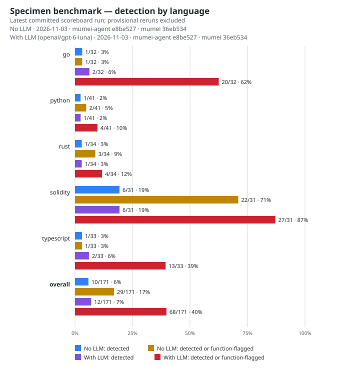
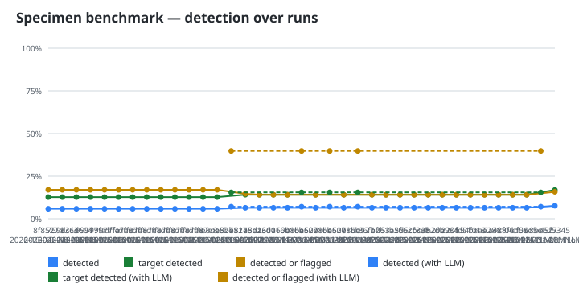

# Specimens: runnable apps with planted defects

This directory holds small, runnable applications and tools in several
languages. Each one works on its happy path but carries deliberately planted
bugs, design mistakes, and vulnerabilities. They exist so that Mumei
(`mumei-agent audit`, `migrate-suggest`, `heal`) and other analyzers can be
measured against a known ground truth.

**Do not deploy any of this code.** Servers bind to `127.0.0.1` only, secrets
are fake, and the Solidity contracts are only meant for a local Foundry test
run.

The corpus is a long-running benchmark: it intentionally includes defect
classes outside what the audit detects today, so the score has room to rise as
the tools improve. `scripts/run_specimen_audits.py` re-runs the audit after
Mumei/mumei-agent updates and records each run in
[`scoreboard/history.json`](scoreboard/history.json); the charts below are
rendered from it.

Scoring is keyword-based: a finding matches a defect when it is reported for
the defect's file, names the defect's function, and carries a keyword for its
category. That can produce false `detected` results when a warning mentions
the right function but is not evidence of that defect.
[`scoreboard/adjudications.json`](scoreboard/adjudications.json) records manual
rulings for those cases. Entries are substring-matched against the finding
text, so when tool wording changes a ruling silently stops applying — review
new `detected` statuses after each tool update.

Every finding also gets a precision status. It is `defect_evidence` when it is
the category evidence for a planted defect. Otherwise a reviewer's ruling under
`finding_reviews` in the same file applies: `real` when the finding points at a
real problem (including a planted defect it was not keyword-matched to, or an
issue the ground truth does not list), `false_positive` when it does not. A
finding with no ruling stays `unreviewed`, and precision is shown as a range
until none are left. Unlike the defect rulings, a finding ruling that matches
nothing in either available audit mode is reported as stale in `AUDIT_SUMMARY.md`
and on stderr.
After editing rulings, `python3 scripts/run_specimen_audits.py --rescore`
re-scores the committed `audit/audit.json` files without running any audit; the
history keeps the original run date and records `rescored_at`.

## Layout

```text
specimens/
  README.md              this file (conventions + catalog)
  DEFECTS.schema.json    JSON Schema for every DEFECTS.json
  <language>/
    <specimen-id>/
      README.md          what the app does and how to run it (no defect spoilers)
      DEFECTS.json       ground truth: every planted defect
      run.sh             runs the happy path; exits 0
      repro.sh           demonstrates every planted defect; exits 0 when all reproduce
      <source files>
      fixed.patch        optional: repairs every planted defect (see "Fixed variants")
      audit/             mumei-agent audit output (generated, see below)
```

Languages are the ones `mumei-agent audit` accepts: `python`, `typescript`,
`go`, `rust`, `solidity`.

Specimen ids are `<lang-prefix>-<NN>-<slug>`, with prefixes `py`, `ts`, `go`,
`rs`, `sol` (for example `py-03-ledger-api`). Defect ids are
`<SPECIMEN-PREFIX><NN>-D<NN>` (for example `PY03-D07`).

## Rules for specimen source code

- The source must look like ordinary code someone might ship. No comments or
  identifiers that point at the planted defects (`BUG`, `vuln`, `unsafe on
  purpose`, `intentionally`, `FIXME: overflow`, ...). The only ground truth is
  `DEFECTS.json`.
- The happy path really works: `run.sh` exits 0 and its output is sensible.
- Every defect is real and observable at runtime (or, for the few design
  defects that are only visible under concurrency or load, reproducible with a
  deterministic harness in `repro.sh`).
- Standard library only, so specimens run offline:
  - Python 3.10+ stdlib (`http.server`, `sqlite3`, `json`, `subprocess`, ...).
  - TypeScript runs directly with Node 22.6+ type stripping
    (`node --experimental-strip-types app.ts`; Node 23.6+ needs no flag). Use
    erasable syntax only: no `enum`, `namespace`, parameter properties, or
    decorators. No npm dependencies.
  - Go 1.22+ stdlib, one `go.mod` per specimen, no third-party modules.
  - Rust stable, one Cargo crate per specimen, no dependencies.
  - Solidity `^0.8.20` in a Foundry project per specimen (`foundry.toml`,
    `src/`, `test/`). Tests must not depend on `forge-std`; declare the few
    cheatcodes you need through a local `interface Vm` at
    `address(uint160(uint256(keccak256("hevm cheat code"))))`.
- Web servers listen on `127.0.0.1` and take the port from `PORT`
  (each specimen has a distinct default port; see the catalog). A `kind: web`
  specimen's README.md must contain a line `Default port: NNNN`, unique
  across specimens (checked by `scripts/check_specimens.py`).
- Files stay small enough for function-level audit: prefer many short
  functions over a few large ones. Roughly half of the defects in each
  specimen should sit in the classes Mumei's audit targets today (arithmetic
  overflow/underflow, division by zero, out-of-bounds, null/None/undefined
  dereference, missing preconditions, broken invariants, invalid state
  transitions, direct hardcoded credentials, reentrancy/access control in
  Solidity). The rest should be outside that set (injection, path traversal,
  auth flaws, races, resource leaks, crypto misuse, design errors) so the
  audit reports also show what is not caught.

## DEFECTS.json

Validated by `DEFECTS.schema.json` and `scripts/check_specimens.py`. Each entry
pins a defect to a file, function, and line, plus an `anchor` substring that
must appear on that line, so the ground truth cannot silently drift from the
code.

```json
{
  "specimen": "py-03-ledger-api",
  "language": "python",
  "kind": "web",
  "summary": "JSON ledger API with accounts, transfers and statements.",
  "defects": [
    {
      "id": "PY03-D01",
      "file": "ledger.py",
      "function": "transfer",
      "line": 42,
      "anchor": "src.balance -= amount",
      "class": "bug",
      "category": "missing-precondition",
      "cwe": "CWE-20",
      "title": "Transfer accepts negative amounts",
      "description": "transfer() never checks amount > 0, so a negative amount moves money from the destination into the source.",
      "trigger": "POST /transfer {\"from\":\"a\",\"to\":\"b\",\"amount\":-50}",
      "observed": "a gains 50 and b loses 50; the request returns 200.",
      "repro": "negative_transfer"
    }
  ]
}
```

- `kind`: `web`, `cli`, `library`, or `contract`.
- `class`: `bug`, `design`, or `vulnerability`.
- `category`: one of the values enumerated in `DEFECTS.schema.json`.
- `cwe`: a `CWE-<n>` id or `null`.
- `repro`: the case name that `repro.sh` prints for this defect.

## repro.sh output contract

`repro.sh` starts whatever it needs (in the background for servers, cleaning up
on exit), runs one case per defect, and prints one line per case:

```text
[REPRODUCED] PY03-D01 negative_transfer: a=150 b=50 after transferring -50
[NOT REPRODUCED] PY03-D02 ...
```

It exits 0 only when every defect listed in `DEFECTS.json` printed
`[REPRODUCED]`.

## Fixed variants

A specimen may ship a `fixed.patch`: a `git diff` relative to the specimen
directory that repairs every planted defect and changes nothing else. The
source files themselves stay as they are. The patch may only modify existing
source files, and its added lines follow the same spoiler-word rule as the
sources. With the patch applied, `run.sh` still passes and `repro.sh` prints no
`[REPRODUCED]` line. Some `repro.sh` cases stop early on the fixed code (they
expect the broken behaviour), so the check looks for reproduced cases, not the
exit code.

To create or update one, edit the sources in place, then:

```bash
S=specimens/python/py-03-ledger-api
git diff --relative=$S -- $S > /tmp/fixed.patch && git checkout -- $S && mv /tmp/fixed.patch $S/fixed.patch
```

The audit runner audits the patched copy too (output in `audit/fixed/`). Any
finding on it is a false alarm unless a `finding_reviews` ruling marks it
`real`.

## Audit reports

`scripts/run_specimen_audits.py` runs `mumei-agent audit` over every specimen
directory and writes `audit/audit.json` and `audit/audit.md`, plus
`audit/coverage.json`, which maps each planted defect to the audit findings
that name the same function. For a specimen with a `fixed.patch` it also
audits a patched copy into `audit/fixed/` and records false alarms on the
fixed code under `fixed` in `coverage.json`. When mumei-agent has an LLM
provider configured, the same files go to `audit/with-llm/` instead, so the
no-LLM and with-LLM audits sit side by side. `specimens/AUDIT_SUMMARY.md`
aggregates detected and missed defects across all specimens.

## Validate

```bash
python3 scripts/check_specimens.py            # every specimen under specimens/
python3 scripts/check_specimens.py specimens/python/py-03-ledger-api
python3 scripts/check_specimens.py --run-fixed  # also run each fixed variant (needs the toolchains)
```

The validator checks each specimen's files, validates `DEFECTS.json` against
`DEFECTS.schema.json`, verifies anchors and line numbers against the source,
scans for spoiler words, and enforces unique `Default port:` values for web
specimens. A `fixed.patch` must apply cleanly and touch only source files;
with `--run-fixed` it is applied to a scratch copy, where `run.sh` must pass and
`repro.sh` must not reproduce anything. It exits non-zero listing every problem found.

<!-- scoreboard:start -->
## Scoreboard





Latest run — no LLM: mumei-agent `15541eb` · mumei `b777e8e` (mumei 0.6.23) · 2026-11-28T01:49:34Z
Findings — no LLM: 32 (defect evidence 18, real 2, false positive 2, unreviewed 10) · precision 62%–94%
Fixed variants — no LLM: 16 specimens (171 defects fixed) · 1 false alarms in 1 findings on fixed code · 0 defects still reported

Latest run — with LLM (`openai/gpt-6-luna`): mumei-agent `e8be527` · mumei `36eb534` (mumei 0.6.23) · 2026-11-03T05:18:58Z
Findings — with LLM (`openai/gpt-6-luna`): 200 (defect evidence 17, real 3, false positive 26, unreviewed 154) · precision 10%–87%
Fixed variants — with LLM (`openai/gpt-6-luna`): 16 specimens (171 defects fixed) · 211 false alarms in 212 findings on fixed code · 5 defects still reported


| Language | Defects | No LLM detected | No LLM detected or flagged | With LLM detected | With LLM detected or flagged |
|---|---:|---:|---:|---:|---:|
| go | 32 | 4/32 (12%) | 6/32 (19%) | 2/32 (6%) | 20/32 (62%) |
| python | 41 | 2/41 (5%) | 5/41 (12%) | 1/41 (2%) | 4/41 (10%) |
| rust | 34 | 3/34 (9%) | 5/34 (15%) | 1/34 (3%) | 4/34 (12%) |
| solidity | 31 | 6/31 (19%) | 15/31 (48%) | 6/31 (19%) | 27/31 (87%) |
| typescript | 33 | 3/33 (9%) | 3/33 (9%) | 2/33 (6%) | 13/33 (39%) |
| **Total** | **171** | **18/171 (11%)** | **34/171 (20%)** | **12/171 (7%)** | **68/171 (40%)** |

Recent runs:

| Date | LLM | mumei-agent | mumei | Defects | Detected % | Target detected % | Flagged % | Precision | False alarms on fixed code | Adjudication |
|---|---|---|---|---|---:|---:|---:|---:|---:|---|
| 2026-11-03 (rescored 2026-11-28) | yes | `e8be527` | `36eb534` | 171 | 7% | 14% | 40% | 10%–87% | 211 / 16 specimens | incomplete (339 unreviewed, 0 stale) |
| 2026-11-28 (rescored 2026-11-28) | no | `15541eb` | `b777e8e` | 171 | 11% | 22% | 20% | 62%–94% | 1 / 16 specimens | incomplete (10 unreviewed, 0 stale) |
| 2026-11-28 | no | `45f5345` | `b777e8e` | 171 | 8% | 17% | 16% | 60%–92% | 1 / 16 specimens | incomplete (8 unreviewed, 0 stale) |
| 2026-11-03 (rescored 2026-11-27) | yes | `e8be527` | `36eb534` | 171 | 7% | 15% | 40% | 10%–87% | 211 / 16 specimens | incomplete (339 unreviewed, 0 stale) |
| 2026-11-27 (rescored 2026-11-27) | no | `cf06d5c` | `b777e8e` | 171 | 6% | 14% | 14% | 57%–91% | 1 / 16 specimens | incomplete (8 unreviewed, 0 stale) |
| 2026-11-27 | no | `cf06d5c` | `b777e8e` | 171 | 6% | 14% | 14% | 57%–91% | 1 / 16 specimens | incomplete (8 unreviewed, 3 stale) |
| 2026-11-27 | no | `7a488f4` | `b777e8e` | 171 | 6% | 14% | 14% | 42%–94% | 4 / 16 specimens | incomplete (16 unreviewed, 0 stale) |
| 2026-11-27 (rescored 2026-11-27) | no | `beaa286` | `b777e8e` | 171 | 6% | 14% | 14% | 37%–83% | 14 / 16 specimens | incomplete (16 unreviewed, 0 stale) |
| 2026-11-27 (rescored 2026-11-27) | no | `554f018` | `b777e8e` | 171 | 6% | 14% | 14% | 37%–83% | 14 / 16 specimens | incomplete (16 unreviewed, 0 stale) |
| 2026-11-27 (rescored 2026-11-27) | no | `220fd51` | `b777e8e` | 171 | 6% | 14% | 14% | 37%–83% | 14 / 16 specimens | incomplete (16 unreviewed, 0 stale) |

Per-specimen details and scoring rules: [AUDIT_SUMMARY.md](AUDIT_SUMMARY.md) (no LLM) and
[AUDIT_SUMMARY_WITH_LLM.md](AUDIT_SUMMARY_WITH_LLM.md) (with LLM).

Re-run:

```bash
python3 scripts/run_specimen_audits.py            # needs a mumei binary; set MUMEI_BIN
                                                # or build ../mumei (cargo build)
python3 scripts/run_specimen_audits.py --render-only   # re-render charts/READMEs only
```

The scoreboard tracks two series: audits run without an LLM provider and audits run with
one. To record a with-LLM run, configure an LLM provider for mumei-agent — `LLM_API_KEY`
(or `OPENAI_API_KEY`), plus `LLM_BASE_URL` / `LLM_MODEL` as needed, or a `.env` file in the
agent repo — and re-run the full audit. A with-LLM run writes to `audit/with-llm/` and records
the model, audit time and (on OpenRouter) cost. Each mode keeps its own history entries and the
tables above show the latest run of each side by side.

Precision is (defect evidence + findings reviewed as real) / findings; it is a range while some
findings are unreviewed, and `—` for runs recorded before findings were classified. Review
verdicts live under `finding_reviews` in `scoreboard/adjudications.json`; after editing them, run
`python3 scripts/run_specimen_audits.py --rescore` to re-score the committed audit output.
When the generated adjudication readiness is incomplete, precision and fixed-alarm totals are
runner scores rather than fresh human-confirmed adjudications. Runs recorded before readiness was
stored show `unknown — rescore`; `--render-only` does not infer them, so run `--rescore` after
reviewing findings to replace the latest legacy state with current readiness. Rescoring updates
the currently saved audit output and appends a new history entry; older rows remain historical
and stay `unknown` when they predate readiness recording.

False alarms on fixed code count findings on specimens with their `fixed.patch` applied (every
planted defect repaired) that no ruling marks as real, shown as false alarms / specimens covered.
<!-- scoreboard:end -->

## Intent-fidelity and fixed-alarm regression gates

`proofs/adversarial/intent-fidelity-corpus.json` pins adversarial generated-contract
and body-port shapes for guard folding, silent repair, vacuous specs, weak specs and
body-port meaning loss. `scripts/check_adversarial_port_corpus.py --check` verifies
that the deterministic fidelity lint still recognizes those shapes and that the
committed `proofs/ADVERSARIAL.md` report is current. Generated-contract warnings are
corpus-side static lint only; they are not yet emitted in contract-benchmark output,
port replay JSON, or audit findings.

`specimens/scoreboard/fixed_alarm_budget.json` pins the accepted no-LLM fixed-variant
false-alarm count. `scripts/check_fixed_alarm_regression.py` recomputes the count from
the committed `audit/coverage.json` artifacts, compares it with the latest no-LLM
history entry, and fails when false alarms or unreviewed fixed findings move above
budget. Lower the budget only after a fresh audited reduction; do not raise it to
hide a regression. The gate is offline and does not rerun `mumei-agent audit`.

```bash
python3 scripts/check_adversarial_port_corpus.py --check
python3 scripts/check_fixed_alarm_regression.py
```

<!-- baselines:start -->
## Compared with baseline analyzers

Generated by `scripts/run_baselines.py`. Each analyzer is scored with the audit's
matching rules on the specimens in its languages only; per-language tables and tool
settings are in [BASELINES.md](BASELINES.md). After a new audit run, refresh this block
with `python3 scripts/run_baselines.py --rescore`.

| Analyzer | Detected | Precision | Fixed-code false alarms |
|---|---|---|---|
| Mumei (no LLM) | 18/171 (11%) | 62%–94% | 1 / 16 specimens |
| bandit | 5/41 (12%) | 88% | 3 / 4 specimens |
| clippy | 0/34 (0%) | n/a | 0 / 3 specimens |
| gosec | 6/32 (19%) | 62% | 15 / 3 specimens |
| semgrep | 9/171 (5%) | 81% | 9 / 16 specimens |
| slither | 11/31 (35%) | 40% | 28 / 3 specimens |

Of 171 defects, 15 are detected only by Mumei (no LLM), 21 only by a baseline, 3 by both and 132 by neither.
<!-- baselines:end -->
